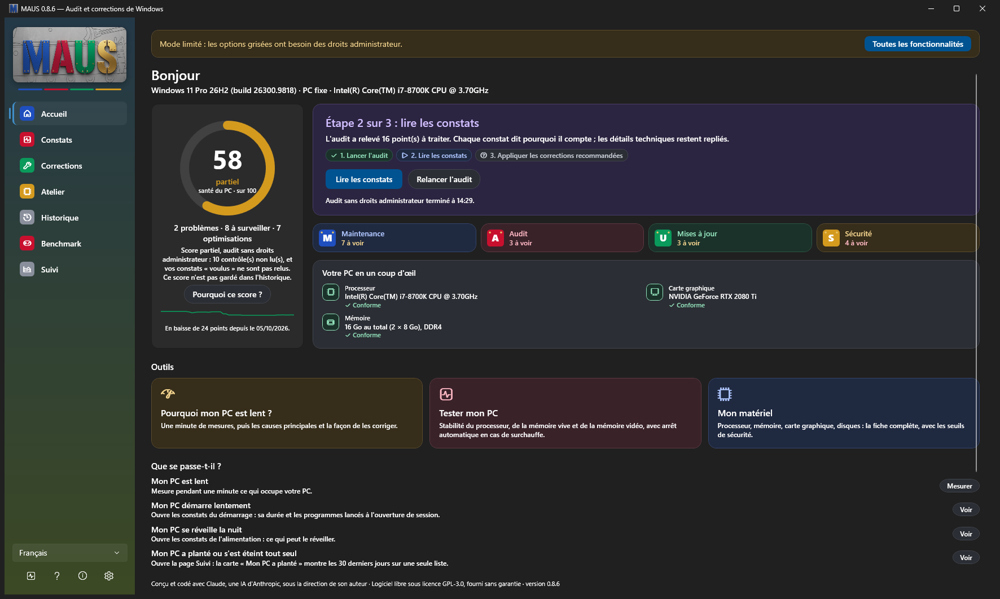
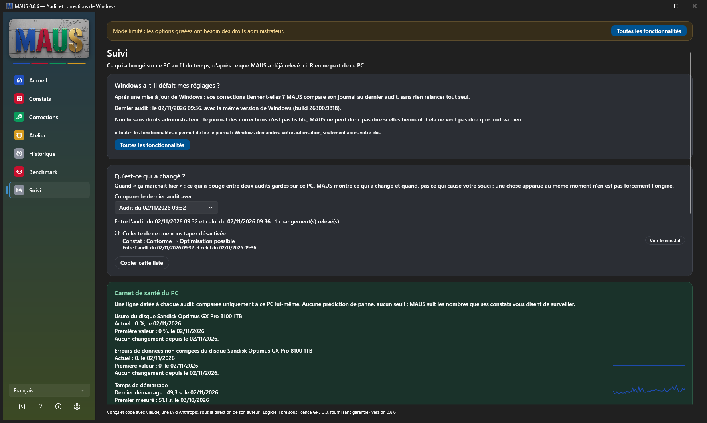
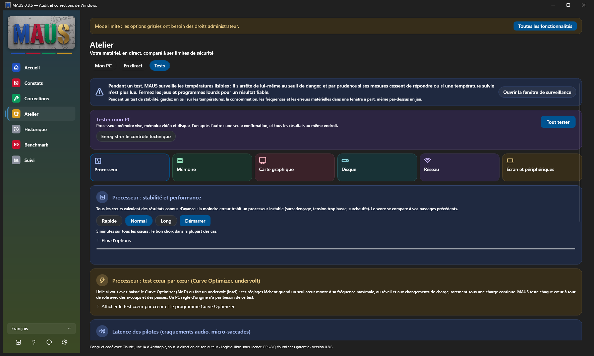
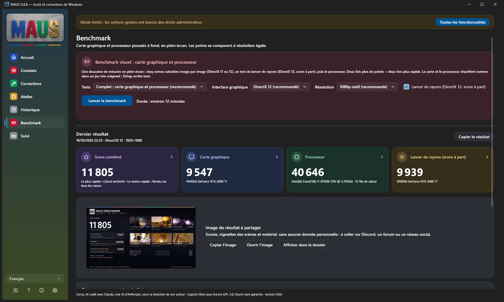
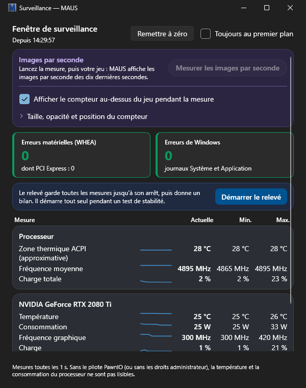

<p align="center"></p>

# MAUS

**Maintenance · Audit · Updates · Sécurité** — l'utilitaire qui audite, répare et optimise Windows 11 en toute transparence.

> MAUS est conçu et codé avec Claude, une IA d'Anthropic, sous la direction de son auteur.

**Gratuit · Libre (GPL-3.0) · Aucune donnée collectée · Version alpha 0.8.6**

**Disponible sur le [Microsoft Store](https://apps.microsoft.com/detail/9NXNPZX2LFQF)** depuis novembre 2026. Ou avec winget :

```powershell
winget install TERMINATORmdel101.MAUS
```

Ou téléchargez l'installateur dans les [Releases](https://github.com/TERMINATORmdel101/MAUS/releases/latest) (voir [Installer](#installer)). Windows 11 23H2 ou plus récent. Aide et questions : [site d'aide de MAUS](https://sites.google.com/view/maus-help/accueil).

## En bref

1. **Lancez l'audit** : MAUS lit votre PC sans rien modifier et vous dit, en français clair, ce qui va, ce qui peut être amélioré et ce qui pose problème.
2. **Choisissez vos corrections** : chacune explique son gain réel et son risque. Point de restauration vérifié (option recommandée), et bouton « Annuler » qui remet les valeurs d'origine, sauf si autre chose a modifié une valeur entre-temps.
3. **Allez plus loin dans l'Atelier** : fiche du matériel, températures en direct, tests du processeur, de la mémoire et de la carte graphique, benchmark visuel.

*In English:* MAUS is a free, open-source Windows 11 utility. It first runs a **read-only audit** (updates, privacy, startup, drivers, hardware health…) and explains every finding in plain language, then lets you choose **reversible fixes** (a verified restore point as a recommended option, original values logged, an undo button). It opens without administrator rights and asks Windows for permission only when an action needs it; from version 0.8.6 the audit also works without them, and a Follow-up page shows what changed over time. No telemetry, no exaggerated performance claims. Available in English, French and Spanish. Alpha version, built with Claude (an AI by Anthropic) under the author's direction. Help: [MAUS help site](https://sites.google.com/view/maus-help/accueil). Available on the [Microsoft Store](https://apps.microsoft.com/detail/9NXNPZX2LFQF).

## Captures d'écran

**Accueil** : après un audit sans droits, le score partiel, les quatre familles M·A·U·S, les outils et « Que se passe-t-il ? ».



**Suivi** : ce qui a bougé sur ce PC au fil du temps, d'après ce que MAUS a déjà relevé ici. Rien ne part du PC.



| Atelier > Tests | Benchmark |
|---|---|
|  |  |
| Processeur, mémoire vive et mémoire vidéo testés à fond, avec arrêt automatique en cas de surchauffe quand la température et sa limite sont lisibles. | Benchmark visuel en plein écran : cinq scènes, un test de lancer de rayons, le processeur. |

<p align="center"></p>

**Fenêtre de surveillance** : images par seconde au-dessus du jeu, erreurs matérielles, températures et fréquences en direct.

## Principes

- **Audit d'abord, action ensuite.** Un scan en lecture seule produit un rapport (vert, bleu, orange, rouge) avant toute modification.
- **Réversible, sauf ce qu'une correction signale.** Les valeurs d'origine sont notées avant chaque changement. Le point de restauration vérifié, créé avant une séance de corrections, est une option recommandée, que vous pouvez décocher ; s'il échoue, MAUS vous demande s'il faut continuer.
- **Tout est expliqué.** Chaque réglage dit ce qu'il fait, ce qu'il apporte, ce qu'il risque et comment revenir en arrière.
- **Rien de dangereux en automatique.** BIOS, XMP/EXPO et overclocking sont guidés, jamais exécutés.
- **Honnête sur les gains.** Les réglages de Windows font gagner quelques pour cent, pas 30 % : MAUS le dit, et ne coupe jamais une protection ou une fonction utile de Windows pour gratter un chiffre.
- **Aucune donnée inventée.** Chaque limite de sécurité du matériel (température, tension) cite sa source publiée ; un seuil de jugement sans source est annoncé comme choisi par MAUS.
- **Aucune télémétrie.** MAUS n'envoie rien à ses auteurs, et n'utilise le réseau que pour une action que vous lancez (voir [PRIVACY](PRIVACY)).

## Ce que fait MAUS

- **Audit** de 20 domaines de Windows 11 (modifications risquées, réparation, mises à jour, confidentialité, alimentation, effets visuels, Game Bar, BIOS, carte graphique, mémoire, santé du matériel, démarrage, sécurité, écran, overclocking, atelier, périphériques, réseau, sauvegardes, logiciels à mettre à jour), résumé par un **score de santé** et les quatre familles **M·A·U·S**. À partir de la 0.8.6, l'audit se fait aussi sans autorisation administrateur (voir [Droits administrateur](#droits-administrateur)). Il dit aussi si le disque est chiffré par BitLocker, avec un encadré avant une mise à jour du BIOS (MAUS ne lit jamais la clé et ne suspend rien lui-même), quelle mise à jour échoue et avec quel code, si Microsoft retient une nouvelle version de Windows, et ce que Microsoft dit des mises à jour et pilotes facultatifs.
- **Corrections réversibles, sauf ce qu'elles signalent**, choisies ligne par ligne ou par profil, avec point de restauration vérifié (option recommandée, décochable ; s'il échoue, MAUS demande s'il faut continuer), journal des valeurs d'origine et bouton **Annuler** (séance entière ou une seule correction).
- **Page Suivi** (à partir de la 0.8.6) : ce que Windows a défait de vos corrections, ce qui a changé entre deux audits, carnet de santé du PC, plantages des 30 derniers jours (écran bleu, bouton, arrêt non expliqué, mise à jour et arrêt demandé sont distingués), démarrages avant et après une séance, pièce changée, audits de la semaine et dossier du PC à imprimer pour une revente ou une réparation. Sans prédiction, sans coupable désigné, et tout reste sur le PC.
- **Atelier matériel** : fiche d'identité du PC, jauges de sécurité (températures, tensions), mesures en direct, gestionnaire des tâches qui explique les processus courants et signale les autres, « Pourquoi mon PC est lent ? » (avec le dernier vrai redémarrage à partir de la 0.8.6), capacité passée de la batterie sur un clic (à partir de la 0.8.6, depuis le début réel des données de Windows), tests du processeur (dont un programme complet pour valider un Curve Optimizer ou un undervolt), de la mémoire vive et de la mémoire vidéo. Arrêt automatique si la température lue atteint le seuil de ralentissement de la carte graphique ou dépasse la limite du processeur, ou si un processeur dont la lecture s'arrête à sa limite (Intel) y reste 10 minutes. La température du processeur demande le pilote PawnIO : sans elle, ou sans limite connue, pas d'arrêt sur ce critère, et MAUS le dit avant le test.
- **Mémoire en détail** (avec le pilote libre PawnIO, installé seulement si vous le voulez) : puce SPD de chaque barrette (profils JEDEC, XMP, EXPO), timings réels sur Ryzen et Intel Core, FCLK / UCLK / MCLK sur Ryzen (Ryzen : pas encore vérifié sur un vrai PC) ; vraie température, tension et consommation du processeur.
- **Images par seconde** au-dessus du jeu, **relevé pendant une partie** (températures, goulots d'étranglement, bilan clair, export CSV) et **historique des scores** pour voir l'effet d'un réglage.
- **Benchmark visuel** (DirectX 11 et 12, lancer de rayons, processeur), avec arrêt de sécurité si la carte graphique atteint son seuil de ralentissement ou si le processeur dépasse une limite connue du catalogue (la lecture d'un processeur Intel s'arrête à sa limite : pas d'arrêt sur ce critère), et comparaison avec un ami. Une passe dure une douzaine de minutes.
- **Audit automatique chaque semaine** (au choix) : MAUS se signale selon votre choix (par défaut : seulement un problème rouge).
- **Stockage** : ce qui prend de la place sur le disque (sans rien supprimer, les dossiers de Windows sont expliqués) et test de vitesse du disque.
- **Réparation officielle** des fichiers de Windows (DISM puis SFC) et **mise à jour des logiciels** choisis (winget), dans une fenêtre visible.
- **Test de connexion**, **rapport HTML** avant/après (il s'imprime depuis le navigateur), et **« Demander de l'aide »** : un résumé de votre PC à coller sur un forum, relu par vous : MAUS en retire le nom d'utilisateur, le nom du PC, l'adresse e-mail, le numéro de série, le domaine Windows et l'identifiant du compte. Un nom complet ou une adresse IP ne sont pas reconnus : c'est à vous de les retirer.
- **Trois langues** : français, anglais, espagnol.

## Droits administrateur

MAUS s'ouvre **sans** les droits administrateur, et sans fenêtre d'autorisation de Windows. À l'ouverture, il vous laisse choisir :

- **Mode limité**, sans droits administrateur : votre matériel, les mesures en direct, les processus, l'espace disque, et l'audit, qui reste en lecture seule et sans aucune demande d'autorisation : son score est alors dit partiel, certains contrôles restent gris, vos constats « voulus » ne sont pas relus, et rien n'est gardé dans l'historique (seul le carnet de santé de la page Suivi note ce qui a pu être lu). Les options qui ont besoin des droits administrateur (corrections, réparation, fiche mémoire…) sont grisées (installer PawnIO ne les demande pas à MAUS, lire les capteurs avec ce pilote oui), et un bandeau en haut de la fenêtre propose « Toutes les fonctionnalités ».
- **Toutes les fonctionnalités**, avec les droits administrateur : toute l'application est disponible, après l'autorisation de Windows. Après 15 minutes sans utilisation, les droits se referment seuls et les options redeviennent grises.

Ces droits ne sont donnés qu'à un **moteur** séparé : il n'accepte qu'une liste fermée d'opérations, par un canal privé réservé à votre compte et à la fenêtre de MAUS (chaque demande est signée et ne peut servir qu'une fois ; au bout de 3 tentatives refusées, il se coupe lui-même et vous prévient), et s'arrête seul après 15 minutes sans demande (jamais pendant un test ou un benchmark) ou à la fermeture de MAUS.

## État du projet

Version actuelle : **0.8.6** (novembre 2026), en **alpha** : à essayer d'abord sur un PC dont les données sont sauvegardées. Elle passe plus de 3 300 tests automatiques, avec registre, WMI et matériel simulés.

**Essayé en vrai sur le PC Windows du porteur du projet** (un seul PC), pendant la préparation de la 0.8.6 : l'audit avec et sans droits administrateur, une correction appliquée puis annulée, un point de restauration, la page Suivi, « Refermer les droits », le benchmark complet en 1440p et en 4K.

**Pas encore essayé en vrai** : la réparation DISM puis SFC avec sa progression, une action sur le pilote graphique, winget et PawnIO lancés sans droits, le bouton « Remettre en place », le benchmark complet en 1080p et en 720p, la capacité passée de la batterie sur un vrai portable, les processeurs AMD, la mémoire DDR5, les cartes graphiques AMD et Intel. Ces parcours ne sont vérifiés que par les tests simulés et la lecture du code.

Dernières versions (le détail de toutes les versions est dans [CHANGELOG.md](CHANGELOG.md)) :

| Version | Nouveautés |
|---|---|
| **0.8.6** | Nouvelle page Suivi (ce que Windows a défait de vos corrections, ce qui a changé entre deux audits, carnet de santé, plantages des 30 derniers jours) ; BitLocker visible et encadré avant une mise à jour du BIOS ; audit sans droits administrateur ; mises à jour qui échouent expliquées ; DISM, SFC et pnputil lancés directement par le moteur avec leur progression ; accueil, Atelier, tests et Paramètres simplifiés ; protections renforcées du moteur |
| 0.8.5 | Relecture complète du code : moteur plus strict (rapport de batterie jamais par le moteur, annulation forcée refusée, actions sur le pilote graphique confirmées par le moteur), fenêtre qui ne se fige plus pendant l'installation de PawnIO, un audit ne double plus l'autre, profils de corrections traduits, document de sécurité du Store rendu exact |
| 0.8.4 (avec la 0.8.3, jamais publiée seule) | Accueil plus simple et plus joli (score qui se remplit, « Votre PC en un coup d'œil », raccourcis clavier) ; confirmation affichée par le moteur administrateur lui-même pour les actions sensibles (fermer un programme, pilote graphique, PawnIO, constat « voulu ») ; benchmark administrateur protégé, « Ouvrir MAUS » après l'audit de la semaine sans droits, bibliothèques verrouillées par leur empreinte ; mode limité clair (options grisées, bandeau « Toutes les fonctionnalités »), sécurité du moteur administrateur : messages signés et protégés contre le rejeu, coupure après 3 tentatives refusées, outils de Windows pris dans System32 seulement, mise à jour des logiciels par winget réparée après un redémarrage du moteur, garde-fous automatiques de sécurité |
| 0.8.2 | « Pourquoi mon PC démarre lentement ? », « Pourquoi se réveille-t-il la nuit ? », écrans bleus expliqués, points de restauration, Wi-Fi voisin ; nouvelles corrections réversibles (tâches d'ouverture de session, Recall, valeurs Windows des effets visuels, fréquence maximale de l'écran avec retour automatique) ; bouton d'aide et « Quoi de neuf » |

MAUS est disponible sur le [Microsoft Store](https://apps.microsoft.com/detail/9NXNPZX2LFQF) depuis novembre 2026. À venir : signature du code, et des essais sur d'autres PC (processeurs AMD, mémoire DDR5, cartes graphiques AMD et Intel).

Configuration requise : Windows 11 23H2 (build 22631) ou plus récent, processeur x64.

## Installer

**Le plus simple : le [Microsoft Store](https://apps.microsoft.com/detail/9NXNPZX2LFQF)**. Ouvrez la fiche de MAUS (ou cherchez « MAUS » dans le Store), puis « Obtenir ». Le paquet du Store est signé par Microsoft : Windows n'affiche pas l'avertissement SmartScreen, et le Store installe les mises à jour.

**Ou avec winget**, le gestionnaire de logiciels intégré à Windows 11. Dans PowerShell ou le Terminal :

```powershell
winget install TERMINATORmdel101.MAUS
```

Chaque version passe la validation du dépôt winget de Microsoft avant sa publication dans le catalogue (analyse antivirus et installation d'essai). Mise à jour : `winget upgrade TERMINATORmdel101.MAUS`.

**Ou à la main :** téléchargez `MAUS-<version>-installation.exe` dans la [dernière version](https://github.com/TERMINATORmdel101/MAUS/releases/latest) et lancez-le. MAUS s'installe dans `Program Files` (dossier protégé, nécessaire à l'audit automatique de la semaine), avec un raccourci dans le menu Démarrer ; .NET est inclus, rien d'autre à installer. Le fichier `.sha256` permet de vérifier que le téléchargement est intact, et chaque installateur est fabriqué par GitHub à partir du code public (vérifiable avec `gh attestation verify MAUS-<version>-installation.exe -R TERMINATORmdel101/MAUS`).

Tant que l'installateur n'est pas signé (voir *Code signing policy* ci-dessous), Windows SmartScreen affiche « Windows a protégé votre ordinateur » : « Informations complémentaires », puis « Exécuter quand même ».

Désinstaller : Paramètres > Applications > Applications installées > MAUS > Désinstaller. Les fichiers, les raccourcis et la tâche de l'audit automatique sont retirés. Le journal des corrections (`%ProgramData%\MAUS\journal`) est gardé : il contient les valeurs d'origine des réglages modifiés. Annulez vos corrections avant de désinstaller si vous voulez retrouver ces valeurs. La désinstallation propose aussi de supprimer les sauvegardes de pilotes, les journaux de diagnostic et les fichiers temporaires (`pilotes`, `logs` et `tasks` dans `%ProgramData%\MAUS`) ; par défaut, ils restent. Restent toujours : vos choix protégés (`%ProgramData%\MAUS\settings`), votre profil (`%LOCALAPPDATA%\MAUS` : choix d'affichage, historique des scores, journaux) et le dossier vide `\MAUS` du Planificateur de tâches. Le pilote PawnIO, s'il a été installé, se retire depuis MAUS ou depuis la liste des applications ; la désinstallation le rappelle.

## Aide et signalements

- **Aide, questions** : [site d'aide de MAUS](https://sites.google.com/view/maus-help/accueil).
- **Un défaut, une idée** : ouvrez une [issue](https://github.com/TERMINATORmdel101/MAUS/issues) (le bouton « Signaler sur GitHub » de MAUS prépare le texte). Le résumé « Demander de l'aide » de MAUS peut y être collé.
- **Une faille de sécurité** : en privé seulement, voir [SECURITY.md](SECURITY.md).

## Code signing policy

MAUS has applied for free code signing by [SignPath.io](https://about.signpath.io), with a certificate from the [SignPath Foundation](https://signpath.org).

**Status:** the application was **declined for now** (October 2026: the project is still too new and not yet widely known); it will be submitted again later. Current releases on GitHub and winget are **not signed**; the Microsoft Store package is signed by Microsoft as part of Store distribution. If it is accepted, only installers built by the project's own build from this repository's source code will be signed.

Team roles:

- Committers and reviewers: [TERMINATORmdel101](https://github.com/TERMINATORmdel101) (maintainer; code written with Claude, an AI by Anthropic, and reviewed by the maintainer)
- Approvers: [TERMINATORmdel101](https://github.com/TERMINATORmdel101)

Privacy policy: this program will not transfer any information to other networked systems unless specifically requested by the user or the person installing or operating it. (MAUS has no telemetry. Network access happens only for actions the user starts: Windows Update search and software update list with winget during an audit the user runs, including the checking audit that follows a fix, an undo, or granting administrator rights when that option is on (the optional weekly audit uses no network); Windows repair (DISM can use Windows Update); software upgrades and the optional PawnIO driver through winget; connection test (pings to your router, Cloudflare 1.1.1.1 and Google 8.8.8.8); Wi-Fi walk (your router only); web search about a process or a component; links to the help site, GitHub, vendor sites and YouTube.) See [PRIVACY](PRIVACY).

*En français :* MAUS a demandé une signature du code gratuite à SignPath.io, avec un certificat de la SignPath Foundation. La demande a été **refusée pour l'instant** (octobre 2026 : projet encore trop récent et peu connu) ; elle sera refaite plus tard. Les versions actuelles ne sont **pas signées**. MAUS n'envoie aucune information sur le réseau sans une action de l'utilisateur.

## Compiler

Prérequis : SDK .NET 10. Pour fabriquer l'installateur ou le paquet du Store : Visual C++ (composant Visual Studio `VC.Tools.x86.x64`, qui compile le lanceur `MAUS.exe`), et [Inno Setup 7](https://jrsoftware.org/isinfo.php) pour l'installateur.

```bash
dotnet build Maus.slnx
dotnet test Maus.slnx
```

Audit en ligne de commande (lecture seule ; certains contrôles demandent une invite de commandes administrateur) :

```bash
dotnet run --project src/Maus.Cli -- --module M06
dotnet run --project src/Maus.Cli -- --lang en --html rapport.html
dotnet run --project src/Maus.Cli -- --summary
dotnet run --project src/Maus.Cli -- --version
```

Corrections en ligne de commande (invite de commandes **administrateur**) : `--plan` affiche les corrections proposées sans rien modifier, `--apply ID...` ou `--apply-recommended` les applique après confirmation (point de restauration vérifié d'abord, sauf avec `--without-restore-point` ; s'il échoue, rien n'est appliqué), `--journal` liste les séances et `--revert SEANCE` remet les valeurs d'origine.

L'application graphique (`src/Maus.App`) s'ouvre sans droits administrateur et lance son moteur (`MAUS.exe --engine`) à la demande. Installateur : `installer\build-installer.ps1` ; paquet du Microsoft Store : `installer\msix\build-msix.ps1` (voir [installer/msix/README.md](installer/msix/README.md)).

## Organisation du code

| Dossier | Rôle |
|---|---|
| `src/Maus.Core/Abstractions` | Contrat des modules (`IAuditModule`), constats, verdicts |
| `src/Maus.Core/Platform` | Lecture du registre, de WMI et de commandes système (liste fermée de commandes en lecture seule) |
| `src/Maus.Core/Engine` | Audit (modules en parallèle) et moteur administrateur (`Broker` : liste fermée d'opérations, canal privé, lancement à la demande) |
| `src/Maus.Core/Fixes` | Corrections réversibles : journal, point de restauration vérifié, Apply / Verify / Revert, profils |
| `src/Maus.Core/Hardware` | Profil matériel commun (fixe ou portable, CPU, GPU) |
| `src/Maus.Core/Rules` et `Catalog` | Règles de registre et catalogues en JSON, chaque seuil avec sa source |
| `src/Maus.Core/Modules` | Un dossier par module d'audit (M01 à M20) |
| `src/Maus.Core/Workshop` | Atelier matériel : inventaire, capteurs, processus, mémoire, tests |
| `src/Maus.Core/Follow` | Page Suivi : comparaisons de relevés déjà gardés, carnet de santé, fiche du matériel, dossier du PC |
| `src/Maus.Core/Localization` | Traductions (le français est la langue source) |
| `src/Maus.Core/Reporting` | Score de santé, rapports texte, JSON et HTML |
| `src/Maus.Bench` | Benchmark visuel (Direct3D 11 et 12) |
| `src/Maus.Cli` | Audit et corrections en ligne de commande |
| `src/Maus.App` | Interface WPF |
| `src/Maus.App/Host` | Lanceur natif du `MAUS.exe` publié (C++) |
| `tests` | Tests automatiques avec registre, WMI et matériel simulés |
| `installer` | Installateur (Inno Setup), paquet winget, paquet du Microsoft Store (MSIX) |
| `tools` | Outil des traductions, images de l'application |
| `third-party` | Licence de PresentMon, livrée avec MAUS |

## Contribuer

Les suggestions d'amélioration sont les bienvenues : ouvrez une *issue* ou proposez une *pull request*. Lisez aussi [TRADEMARKS.md](TRADEMARKS.md) : le nom MAUS est réservé à la version officielle.

## Licence

MAUS est un logiciel libre distribué sous licence **GNU GPL version 3** (GPL-3.0-only, texte complet dans [LICENSE](LICENSE)), avec les conditions additionnelles de l'article 7 décrites dans [TRADEMARKS.md](TRADEMARKS.md). Il est fourni sans aucune garantie.

MAUS est un logiciel indépendant. Il n'est affilié ni à Microsoft, NVIDIA, AMD, Intel ou Anthropic, ni approuvé par eux. Windows et Xbox sont des marques du groupe Microsoft ; les autres marques citées appartiennent à leurs propriétaires respectifs.
