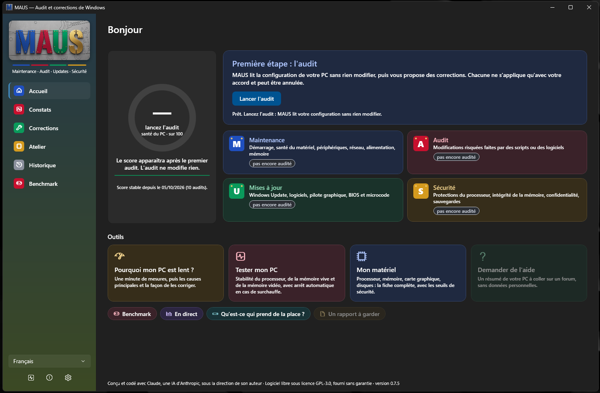
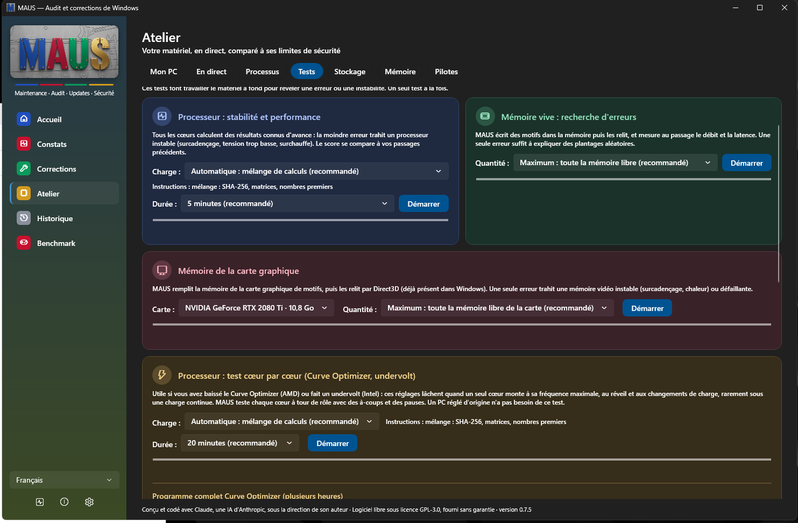
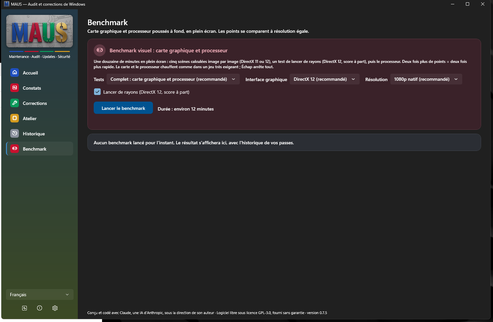
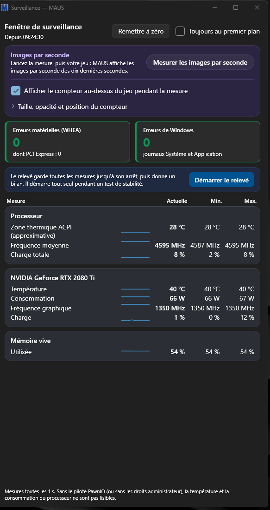

<p align="center"></p>

# MAUS

**Maintenance · Audit · Updates · Sécurité** — l'utilitaire qui audite, répare et optimise Windows 11 en toute transparence.

> MAUS est conçu et codé avec Claude, une IA d'Anthropic, sous la direction de son auteur.

**Gratuit · Libre (GPL-3.0) · Aucune donnée collectée · Version alpha 0.8.3**

```powershell
winget install TERMINATORmdel101.MAUS
```

Ou téléchargez l'installateur dans les [Releases](https://github.com/TERMINATORmdel101/MAUS/releases/latest) (voir [Installer](#installer)). Windows 11 23H2 ou plus récent. Aide et questions : [site d'aide de MAUS](https://sites.google.com/view/maus-help/accueil).

## En bref

1. **Lancez l'audit** : MAUS lit votre PC sans rien modifier et vous dit, en français clair, ce qui va, ce qui peut être amélioré et ce qui pose problème.
2. **Choisissez vos corrections** : chacune explique son gain réel et son risque. Point de restauration vérifié, et bouton « Annuler » pour tout remettre comme avant.
3. **Allez plus loin dans l'Atelier** : fiche du matériel, températures en direct, tests du processeur, de la mémoire et de la carte graphique, benchmark visuel.

*In English:* MAUS is a free, open-source Windows 11 utility. It first runs a **read-only audit** (updates, privacy, startup, drivers, hardware health…) and explains every finding in plain language, then lets you choose **reversible fixes** (verified restore point, original values logged, one-click undo). It opens without administrator rights and asks Windows for permission only when an action needs it. No telemetry, no exaggerated performance claims. Available in English, French and Spanish. Alpha version, built with Claude (an AI by Anthropic) under the author's direction. Help: [MAUS help site](https://sites.google.com/view/maus-help/accueil).

## Captures d'écran

**Accueil** : le score de santé du PC, les quatre familles M·A·U·S et les outils.



| Atelier > Tests | Benchmark |
|---|---|
|  |  |
| Processeur, mémoire vive et mémoire vidéo testés à fond, avec arrêt automatique en cas de surchauffe. | Benchmark visuel en plein écran : cinq scènes, un test de lancer de rayons, le processeur. |

<p align="center"></p>

**Fenêtre de surveillance** : images par seconde au-dessus du jeu, erreurs matérielles, températures et fréquences en direct.

## Principes

- **Audit d'abord, action ensuite.** Un scan en lecture seule produit un rapport (vert, bleu, orange, rouge) avant toute modification.
- **Tout est réversible.** Point de restauration vérifié et sauvegarde des valeurs d'origine avant chaque changement.
- **Tout est expliqué.** Chaque réglage dit ce qu'il fait, ce qu'il apporte, ce qu'il risque et comment revenir en arrière.
- **Rien de dangereux en automatique.** BIOS, XMP/EXPO et overclocking sont guidés, jamais exécutés.
- **Honnête sur les gains.** Les réglages de Windows font gagner quelques pour cent, pas 30 % : MAUS le dit, et ne coupe jamais une protection ou une fonction utile de Windows pour gratter un chiffre.
- **Aucune donnée inventée.** Chaque seuil (température, tension) cite sa source publiée ; sans source, pas de seuil ni d'alarme.
- **Aucune télémétrie.** MAUS n'envoie rien.

## Ce que fait MAUS

- **Audit** de 20 domaines de Windows 11 (modifications risquées, réparation, mises à jour, confidentialité, alimentation, effets visuels, Game Bar, BIOS, carte graphique, mémoire, santé du matériel, démarrage, sécurité, écran, overclocking, atelier, périphériques, réseau, sauvegardes, logiciels à mettre à jour), résumé par un **score de santé** et les quatre familles **M·A·U·S**.
- **Corrections réversibles**, choisies ligne par ligne ou par profil, avec point de restauration vérifié, journal des valeurs d'origine et bouton **Annuler** (séance entière ou une seule correction).
- **Atelier matériel** : fiche d'identité du PC, jauges de sécurité (températures, tensions), mesures en direct, gestionnaire des tâches qui explique chaque processus, « Pourquoi mon PC est lent ? », tests du processeur (dont un programme complet pour valider un Curve Optimizer ou un undervolt), de la mémoire vive et de la mémoire vidéo, avec arrêt automatique en cas de surchauffe.
- **Mémoire en détail** (avec le pilote libre PawnIO, installé seulement si vous le voulez) : puce SPD de chaque barrette (profils JEDEC, XMP, EXPO), timings réels sur Ryzen et Intel Core, FCLK / UCLK / MCLK sur Ryzen ; vraie température, tension et consommation du processeur.
- **Images par seconde** au-dessus du jeu, **relevé pendant une partie** (températures, goulots d'étranglement, bilan clair, export CSV) et **historique des scores** pour voir l'effet d'un réglage.
- **Benchmark visuel** (DirectX 11 et 12, lancer de rayons, processeur), avec arrêt de sécurité en cas de surchauffe et comparaison avec un ami.
- **Audit automatique chaque semaine** (au choix) : MAUS ne se montre que s'il trouve un problème rouge.
- **Stockage** : ce qui prend de la place sur le disque (sans rien supprimer, les dossiers de Windows sont expliqués) et test de vitesse du disque.
- **Réparation officielle** des fichiers de Windows (DISM puis SFC) et **mise à jour des logiciels** choisis (winget), dans une fenêtre visible.
- **Test de connexion**, **rapport HTML** avant/après, et **« Demander de l'aide »** : un résumé de votre PC à coller sur un forum, relu par vous, sans nom d'utilisateur, nom du PC, adresse e-mail ni numéro de série.
- **Trois langues** : français, anglais, espagnol.

## Droits administrateur

MAUS s'ouvre **sans** les droits administrateur, et sans fenêtre d'autorisation de Windows. À l'ouverture, il vous laisse choisir :

- **Mode limité**, sans droits administrateur : votre matériel, les mesures en direct, les processus et l'espace disque. Pour le reste, Windows vous demande l'autorisation seulement quand vous lancez une action qui en a besoin (audit complet, corrections, réparation, capteurs avancés, fiche mémoire…). Si vous refusez, seule cette action est annulée.
- **Toutes les fonctionnalités**, avec les droits administrateur : toute l'application est disponible, après l'autorisation de Windows.

Ces droits ne sont donnés qu'à un **moteur** séparé : il n'accepte qu'une liste fermée d'opérations, par un canal privé réservé à votre compte et à la fenêtre de MAUS (chaque demande est signée et ne peut servir qu'une fois), et s'arrête seul après 15 minutes sans demande (jamais pendant un test ou un benchmark) ou à la fermeture de MAUS.

## État du projet

Version actuelle : **0.8.3** (octobre 2026), en **alpha** : à essayer d'abord sur un PC dont les données sont sauvegardées. Tout est testé avec plus de 1 500 tests automatiques, puis sur le PC Windows du porteur du projet ; ce qui n'a pas encore été vérifié sur un vrai matériel est signalé dans l'application.

Dernières versions (le détail de toutes les versions est dans [CHANGELOG.md](CHANGELOG.md)) :

| Version | Nouveautés |
|---|---|
| **0.8.3** | Sécurité du moteur administrateur : messages signés et protégés contre le rejeu, outils de Windows pris dans System32 seulement, mise à jour des logiciels par winget réparée après un redémarrage du moteur, garde-fous automatiques de sécurité |
| 0.8.2 | « Pourquoi mon PC démarre lentement ? », « Pourquoi se réveille-t-il la nuit ? », écrans bleus expliqués, points de restauration, Wi-Fi voisin ; nouvelles corrections réversibles (tâches d'ouverture de session, Recall, valeurs Windows des effets visuels, fréquence maximale de l'écran avec retour automatique) ; bouton d'aide et « Quoi de neuf » |
| 0.8.1 | Plus de demande d'autorisation à l'ouverture : MAUS propose d'activer toutes les fonctionnalités, et Windows ne demande l'autorisation qu'au moment voulu ; droits refermés après 15 minutes sans utilisation ; onglet Mémoire des processeurs Intel corrigé (horloge, nanosecondes, tWR et tRTP) ; paquet pour le Microsoft Store |
| 0.8.0 | Fenêtre de MAUS sans droits administrateur, moteur séparé pour les lectures profondes et les corrections ; revue de sécurité (retours arrière ratés gardés visibles, arrêt de sécurité du benchmark, plus de faux « stable » dans les tests) |

À venir : publication sur le **Microsoft Store** (en cours), signature du code, et des essais sur d'autres PC (processeurs AMD, mémoire DDR5, cartes graphiques AMD et Intel).

Configuration requise : Windows 11 23H2 (build 22631) ou plus récent, processeur x64.

## Installer

**Le plus simple : winget**, le gestionnaire de logiciels intégré à Windows 11. Dans PowerShell ou le Terminal :

```powershell
winget install TERMINATORmdel101.MAUS
```

Chaque version est vérifiée par Microsoft avant sa publication dans le catalogue winget (analyse antivirus et installation d'essai). Mise à jour : `winget upgrade TERMINATORmdel101.MAUS`.

**Ou à la main :** téléchargez `MAUS-<version>-installation.exe` dans la [dernière version](https://github.com/TERMINATORmdel101/MAUS/releases/latest) et lancez-le. MAUS s'installe dans `Program Files` (dossier protégé, nécessaire à l'audit automatique de la semaine), avec un raccourci dans le menu Démarrer ; .NET est inclus, rien d'autre à installer. Le fichier `.sha256` permet de vérifier que le téléchargement est intact, et chaque installateur est fabriqué par GitHub à partir du code public (vérifiable avec `gh attestation verify MAUS-<version>-installation.exe -R TERMINATORmdel101/MAUS`).

Tant que l'installateur n'est pas signé (voir *Code signing policy* ci-dessous), Windows SmartScreen affiche « Windows a protégé votre ordinateur » : « Informations complémentaires », puis « Exécuter quand même ».

Désinstaller : Paramètres > Applications > Applications installées > MAUS > Désinstaller. Les fichiers, les raccourcis et la tâche de l'audit automatique sont retirés. Le journal des corrections (`%ProgramData%\MAUS`) est gardé : il contient les valeurs d'origine des réglages modifiés. Annulez vos corrections avant de désinstaller si vous voulez retrouver ces valeurs. Le pilote PawnIO, s'il a été installé, se retire depuis MAUS ou depuis la liste des applications.

## Aide et signalements

- **Aide, questions** : [site d'aide de MAUS](https://sites.google.com/view/maus-help/accueil).
- **Un défaut, une idée** : ouvrez une [issue](https://github.com/TERMINATORmdel101/MAUS/issues) (le bouton « Signaler sur GitHub » de MAUS prépare le texte). Le résumé « Demander de l'aide » de MAUS peut y être collé.
- **Une faille de sécurité** : en privé seulement, voir [SECURITY.md](SECURITY.md).

## Code signing policy

MAUS has applied for free code signing by [SignPath.io](https://about.signpath.io), with a certificate from the [SignPath Foundation](https://signpath.org).

**Status:** the application was **declined for now** (October 2026: the project is still too new and not yet widely known); it will be submitted again later. Current releases are **not signed**. If it is accepted, only installers built by the project's own build from this repository's source code will be signed.

Team roles:

- Committers and reviewers: [TERMINATORmdel101](https://github.com/TERMINATORmdel101) (maintainer; code written with Claude, an AI by Anthropic, and reviewed by the maintainer)
- Approvers: [TERMINATORmdel101](https://github.com/TERMINATORmdel101)

Privacy policy: this program will not transfer any information to other networked systems unless specifically requested by the user or the person installing or operating it. (MAUS has no telemetry. Network access happens only for actions the user starts: Windows Update search during an audit, software update list with winget, web search about a process, connection test, links to the help site and to GitHub.) See [PRIVACY](PRIVACY).

*En français :* MAUS a demandé une signature du code gratuite à SignPath.io, avec un certificat de la SignPath Foundation. La demande a été **refusée pour l'instant** (octobre 2026 : projet encore trop récent et peu connu) ; elle sera refaite plus tard. Les versions actuelles ne sont **pas signées**. MAUS n'envoie aucune information sur le réseau sans une action de l'utilisateur.

## Compiler

Prérequis : SDK .NET 10 (et [Inno Setup 7](https://jrsoftware.org/isinfo.php) pour l'installateur).

```bash
dotnet build Maus.slnx
dotnet test Maus.slnx
```

Audit en ligne de commande (lecture seule ; certains contrôles demandent une invite de commandes administrateur) :

```bash
dotnet run --project src/Maus.Cli -- --module M06
dotnet run --project src/Maus.Cli -- --lang en --html rapport.html
dotnet run --project src/Maus.Cli -- --summary
dotnet run --project src/Maus.Cli -- --version
```

Corrections en ligne de commande (invite de commandes **administrateur**) : `--plan` affiche les corrections proposées sans rien modifier, `--apply ID...` ou `--apply-recommended` les applique après confirmation (point de restauration vérifié d'abord), `--journal` liste les séances et `--revert SEANCE` remet les valeurs d'origine.

L'application graphique (`src/Maus.App`) s'ouvre sans droits administrateur et lance son moteur (`MAUS.exe --engine`) à la demande. Installateur : `installer\build-installer.ps1` ; paquet du Microsoft Store : `installer\msix\build-msix.ps1` (voir [installer/msix/README.md](installer/msix/README.md)).

## Organisation du code

| Dossier | Rôle |
|---|---|
| `src/Maus.Core/Abstractions` | Contrat des modules (`IAuditModule`), constats, verdicts |
| `src/Maus.Core/Platform` | Lecture du registre, de WMI et de commandes système (liste fermée de commandes en lecture seule) |
| `src/Maus.Core/Engine` | Audit (modules en parallèle) et moteur administrateur (`Broker` : liste fermée d'opérations, canal privé, lancement à la demande) |
| `src/Maus.Core/Fixes` | Corrections réversibles : journal, point de restauration vérifié, Apply / Verify / Revert, profils |
| `src/Maus.Core/Hardware` | Profil matériel commun (fixe ou portable, CPU, GPU) |
| `src/Maus.Core/Rules` et `Catalog` | Règles de registre et catalogues en JSON, chaque seuil avec sa source |
| `src/Maus.Core/Modules` | Un dossier par module de la fiche technique (M01 à M20) |
| `src/Maus.Core/Workshop` | Atelier matériel : inventaire, capteurs, processus, mémoire, tests |
| `src/Maus.Core/Localization` | Traductions (le français est la langue source) |
| `src/Maus.Core/Reporting` | Score de santé, rapports texte, JSON et HTML |
| `src/Maus.Bench` | Benchmark visuel (Direct3D 11 et 12) |
| `src/Maus.Cli` | Audit et corrections en ligne de commande |
| `src/Maus.App` | Interface WPF |
| `tests` | Tests automatiques avec registre, WMI et matériel simulés |
| `installer` | Installateur (Inno Setup), paquet winget, paquet du Microsoft Store (MSIX) |

## Contribuer

Les suggestions d'amélioration sont les bienvenues : ouvrez une *issue* ou proposez une *pull request*. Lisez aussi [TRADEMARKS.md](TRADEMARKS.md) : le nom MAUS est réservé à la version officielle.

## Licence

MAUS est un logiciel libre distribué sous licence **GNU GPL version 3** (GPL-3.0-only, texte complet dans [LICENSE](LICENSE)), avec les conditions additionnelles de l'article 7 décrites dans [TRADEMARKS.md](TRADEMARKS.md). Il est fourni sans aucune garantie.

MAUS est un logiciel indépendant. Il n'est affilié ni à Microsoft, NVIDIA, AMD, Intel ou Anthropic, ni approuvé par eux. Windows et Xbox sont des marques du groupe Microsoft ; les autres marques citées appartiennent à leurs propriétaires respectifs.
